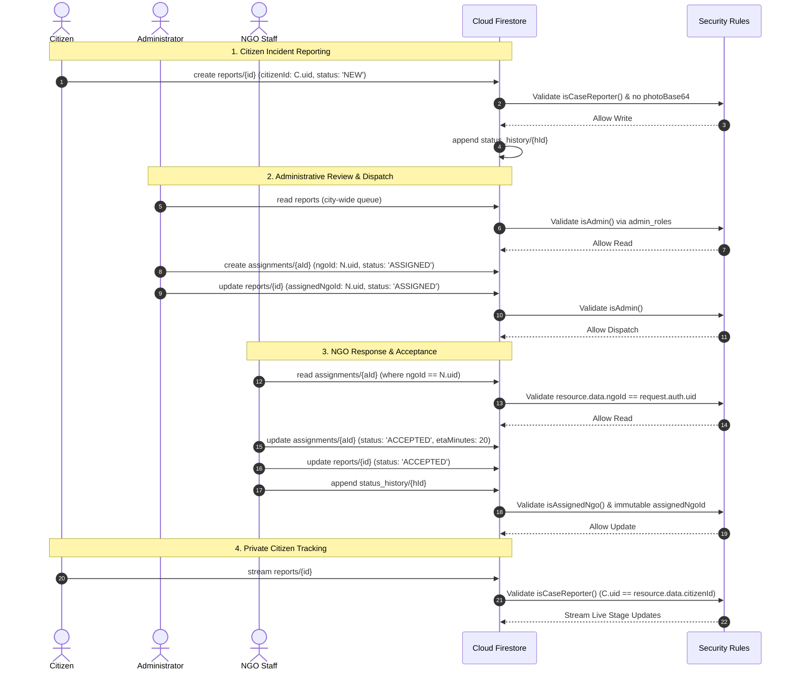
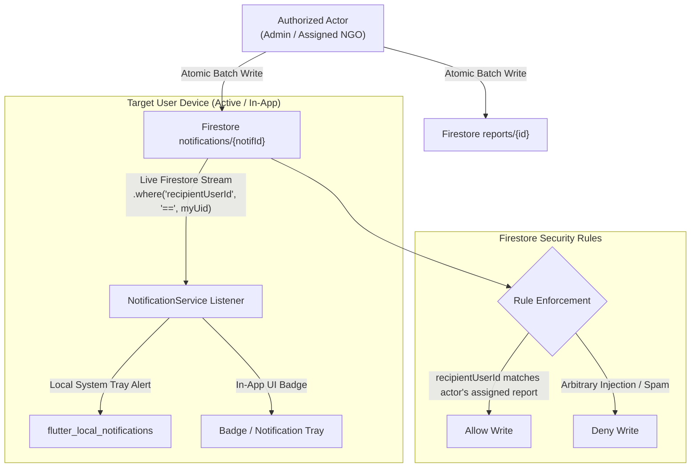

# PAW AID — Phase 2: Secure Firebase Architecture Design

**Project ID:** `paw-aid-app`  
**Firebase Plan:** Spark Tier ($0.00 / month — Strictly Free; No Billing)  
**Authentication Provider:** Firebase Auth (Email/Password)  
**Target Roles:** `CITIZEN`, `NGO` (`ngo_staff`), `ADMIN`  
**Document Status:** Architecture Design Completed — Awaiting Approval Prior to Implementation

---

## 1. Architectural Principles & Spark Tier Invariants

PAW AID is designed as a production-grade, zero-cost emergency animal rescue network. It operates strictly within the **Firebase Spark Tier ($0.00 / month)** with hard system and cost invariants:

1. **₹0 Monthly Budget:** Zero billing account, zero Blaze upgrade, zero payment card attachments.
2. **Zero Cloud Functions / Cloud Run:** All authorization, state progression, and business rules are enforced via **declarative Cloud Firestore Security Rules** and client-side reactive state machines.
3. **Zero Firebase Storage Bucket Spend:** Firebase Storage buckets are restricted or require billing for scalable production use. All animal distress photographs remain securely stored on the reporting user's local physical device via `PhotoStorageRepository`. Only local URI references and upload status indicators are stored in Firestore.
4. **Strictly No Base64 Blobs in Cloud Firestore:** No document or subcollection shall persist raw byte arrays or Base64 encoded images. Documents remain lightweight (< 2 KB average), keeping database storage well within Spark's 1 GiB limit.
5. **Single Source of Truth (`reports`):** All legacy dual-write targets (`rescue_cases` and `cases`) are eliminated. The `reports` collection is the sole canonical collection for animal distress incidents.
6. **Strict RBAC & Least Privilege:**
   * **Citizens:** Can view and stream *only their own private reports* (`citizenId == request.auth.uid`). They have zero access to reports submitted by other citizens.
   * **NGOs:** Can view and update *only reports assigned to their organization* (`assignedNgoId == request.auth.uid`). NGOs cannot self-assign reports or access the broader queue without explicit administrator dispatch.
   * **Administrators:** Can view all city-wide cases, manage NGO verifications, dispatch assignments, and inspect platform analytics.
7. **Tamper-Proof Administrator Authority (`admin_roles/{uid}`):** Administrator privileges are decoupled from the user's editable Firestore document. Authorization is proven exclusively by the presence of the user's UID in a sealed collection `admin_roles/{uid}` (where client writes are strictly denied: `allow write: if false;`) or cryptographically verified Custom Claims.

---

## 2. Final Firestore Schema & Document Specifications

```
cloud_firestore/
├── admin_roles/{adminUid}                   # Sealed administrative authority collection (read-only to clients)
├── users/{userId}                          # Canonical user profiles & account states
├── ngos/{ngoId}                            # Verified & pending NGO directory (ngoId == Auth UID)
├── reports/{reportId}                      # Canonical animal distress incidents
│   ├── status_history/{historyId}          # Append-only chronological audit log
│   └── comments/{commentId}                # Threaded incident communications
├── assignments/{assignmentId}              # Administrative dispatch records
└── notifications/{notificationId}          # Secure targeted notifications
```

---

### 2.1 Collection: `admin_roles/{adminUid}`
* **Purpose:** Provable administrator authority store under Firebase Spark.
* **Document ID:** Firebase Auth UID of the authorized administrator (`adminUid`).
* **Client Write Permissions:** `allow write: if false;` (Strictly prohibited to all client SDKs).
* **Document Fields:**

| Field Name | Type | Constraints / Description |
| :--- | :--- | :--- |
| `role` | `String` | Constant value `'admin'`. |
| `grantedAt` | `Timestamp` | Server timestamp when administrative privileges were provisioned. |
| `grantedBy` | `String` | Console operator or provisioning script identifier. |
| `notes` | `String?` | Optional administrative justification or role scope. |

---

### 2.2 Collection: `users/{userId}`
* **Purpose:** User identity, profile metadata, role classification, and account lifecycle state.
* **Document ID:** Firebase Auth UID (`request.auth.uid`).
* **Document Fields:**

| Field Name | Type | Invariant / Validation Rule |
| :--- | :--- | :--- |
| `id` / `uid` | `String` | Exactly matches document ID and `request.auth.uid`. Immutable. |
| `email` | `String` | Lowercase trimmed email matching standard RFC regex. Max 100 chars. |
| `role` | `String` | One of `['citizen', 'ngo_staff']`. Public registration cannot set `'admin'`. |
| `accountStatus` | `String` | Citizens initialize as `'active'`. NGOs initialize as `'pending'`. Immutable by non-admins. |
| `fullName` | `String?` | Display name, 1..100 characters. |
| `phoneNumber` | `String?` | Contact phone, 5..30 characters. |
| `fcmToken` | `String?` | Device push registration token, 1..500 characters. |
| `createdAt` | `Timestamp` | Set once via `FieldValue.serverTimestamp()`. Immutable. |
| `updatedAt` | `Timestamp` | Updated on profile change via `FieldValue.serverTimestamp()`. |

---

### 2.3 Collection: `ngos/{ngoId}`
* **Purpose:** Animal welfare organization directory, credentials, and operational capacity.
* **Document ID:** NGO Firebase Auth UID (`ngoId == request.auth.uid`). *Eliminates legacy `ngo_${timestamp}` mismatch.*
* **Document Fields:**

| Field Name | Type | Invariant / Validation Rule |
| :--- | :--- | :--- |
| `id` / `ngoId` | `String` | Matches authenticated user UID. Immutable. |
| `name` | `String` | Registered organization name, 1..150 characters. |
| `registrationNumber` | `String` | Government NGO registration number, 1..100 characters. Immutable by NGO. |
| `email` | `String` | Official contact email. Max 100 characters. |
| `phone` | `String` | Hotline phone, 5..30 characters. |
| `city` | `String` | City name, 1..100 characters. |
| `state` | `String` | State name, 1..100 characters. |
| `address` | `String` | Physical facility address, 1..300 characters. |
| `latitude` | `Double` | Geographical latitude (-90.0 .. +90.0). |
| `longitude` | `Double` | Geographical longitude (-180.0 .. +180.0). |
| `serviceRadiusKm` | `Double` | Operating coverage radius (0.0 .. 500.0 km). Default 25.0. |
| `specializations` | `List<String>`| Species treated (e.g. `['Dog', 'Cat', 'Large Animals']`). Max 20 items. |
| `status` | `String` | One of `['pending', 'approved', 'rejected']`. Initial registration MUST be `'pending'`. Only Admin can change to `'approved'`. |
| `rejectionReason` | `String?` | Audit feedback from administrator if rejected. Max 500 chars. |
| `numVehicles` | `Int` | Active rescue vehicles count (0..1000). |
| `numVolunteers` | `Int` | Active field volunteer count (0..10000). |
| `activeCasesCount` | `Int` | Currently ongoing rescues. |
| `totalRescued` | `Int` | Cumulative completed rescues. |
| `successRate` | `Double` | Historical rescue success ratio (0.0 .. 1.0). |
| `createdAt` | `Timestamp` | Submission timestamp. Immutable. |
| `updatedAt` | `Timestamp` | Last modification timestamp. |

---

### 2.4 Collection: `reports/{reportId}`
* **Purpose:** Canonical store for all animal distress incidents.
* **Document ID:** UUID v4 string (`reportId`).
* **Document Fields:**

| Field Name | Type | Invariant / Validation Rule |
| :--- | :--- | :--- |
| `reportId` | `String` | Unique UUID v4. Immutable. |
| `citizenId` | `String` | Auth UID of reporting citizen. Immutable. Matches `request.auth.uid`. |
| `citizenName` | `String?` | Reporting citizen display name. Max 100 characters. |
| `citizenPhone` | `String?` | Citizen contact phone for rescue verification. Max 30 characters. |
| `animalType` | `String` | Species reported (e.g. `'Dog'`, `'Cat'`, `'Cow'`, `'Bird'`). Max 50 characters. |
| `animalDescription`| `String?` | Condition and triage notes. 0..5000 characters. |
| `injuryCategory` | `String` | Preliminary injury classification. Max 100 characters. |
| `severity` | `String` | Standard priority: `'LOW'`, `'MEDIUM'`, `'HIGH'`, `'CRITICAL'`. |
| `latitude` | `Double` | Incident GPS latitude (-90.0 .. +90.0). |
| `longitude` | `Double` | Incident GPS longitude (-180.0 .. +180.0). |
| `address` | `String?` | Reverse-geocoded physical address. Max 500 characters. |
| `photoReference` | `String?` | On-device file URI or pending upload indicator. Max 500 characters. |
| `photoUploadStatus`| `String` | One of `['localOnly', 'pendingStorageProvider']`. |
| `assignedNgoId` | `String?` | Auth UID of assigned NGO. Null until dispatched by Admin. Non-admins cannot set this field. |
| `assignedNgoName` | `String?` | Display name of assigned NGO. Max 150 characters. |
| `reportStatus` | `String` | 9-Stage Canonical Status: `'NEW'`, `'UNDER_REVIEW'`, `'ASSIGNED'`, `'ACCEPTED'`, `'RESCUER_ON_THE_WAY'`, `'ANIMAL_RESCUED'`, `'TREATMENT_IN_PROGRESS'`, `'RESOLVED'`, `'REJECTED'`. |
| `aiAnalysis` | `Map?` | On-device vision triage output map. |
| `createdAt` | `Timestamp` | Submission timestamp via `serverTimestamp()`. Immutable. |
| `updatedAt` | `Timestamp` | Last stage update timestamp via `serverTimestamp()`. |

> [!CAUTION]
> **Strict Base64 Ban:** The field `photoBase64` is permanently eliminated. Any attempt to write `photoBase64` will be rejected by Firestore Security Rules.

---

### 2.5 Subcollection: `reports/{reportId}/status_history/{historyId}`
* **Purpose:** Append-only chronological audit log of all rescue stage transitions.
* **Document ID:** Subcollection document UUID v4.
* **Client Permissions:** Append-only (`allow create: if ...; allow update, delete: if false;`).
* **Document Fields:**

| Field Name | Type | Invariant / Validation Rule |
| :--- | :--- | :--- |
| `historyId` | `String` | Unique history document UUID. |
| `reportId` | `String` | Matches parent `reportId`. Immutable. |
| `previousStatus` | `String?` | Status code before transition. Max 50 characters. |
| `newStatus` | `String` | Status code after transition. Max 50 characters. |
| `actorId` | `String` | Auth UID of user effecting the change (`request.auth.uid`). |
| `actorRole` | `String` | Role of actor: `'citizen'`, `'ngo_staff'`, `'admin'`. |
| `notes` | `String?` | Optional stage transition notes or medical update. Max 2000 characters. |
| `photoReference` | `String?` | Local evidence photo URI on device. Max 500 characters. |
| `timestamp` | `Timestamp` | Transition server timestamp. |

---

### 2.6 Subcollection: `reports/{reportId}/comments/{commentId}`
* **Purpose:** Threaded incident notes between citizen reporter, assigned NGO responder, and administrators.
* **Document ID:** Auto-generated ID.
* **Document Fields:** `id`, `authorId`, `authorName`, `text` (1..2000 chars), `createdAt`.

---

### 2.7 Collection: `assignments/{assignmentId}`
* **Purpose:** Formal dispatch records and mission tracking.
* **Document ID:** UUID v4.
* **Document Fields:**

| Field Name | Type | Invariant / Validation Rule |
| :--- | :--- | :--- |
| `assignmentId` | `String` | Unique assignment UUID. Immutable. |
| `reportId` | `String` | References `reports/{reportId}`. Immutable. |
| `ngoId` | `String` | Auth UID of target NGO. Immutable. |
| `ngoName` | `String` | Display name of target NGO. Max 150 characters. |
| `status` | `String` | `'ASSIGNED'`, `'ACCEPTED'`, `'REJECTED'`, `'COMPLETED'`. |
| `assignedBy` | `String` | Admin UID who initiated dispatch. Non-admins cannot create assignments. |
| `etaMinutes` | `Int?` | Estimated arrival minutes (0..10080). |
| `notes` | `String?` | Dispatch or acceptance notes. Max 2000 characters. |
| `rejectionReason` | `String?` | Mandatory explanation if rejected by NGO. Max 1000 characters. |
| `createdAt` | `Timestamp` | Creation timestamp via `serverTimestamp()`. Immutable. |
| `updatedAt` | `Timestamp` | Status change timestamp via `serverTimestamp()`. |

---

### 2.8 Collection: `notifications/{notificationId}`
* **Purpose:** In-app operational notifications for citizens, NGOs, and administrators.
* **Document ID:** UUID v4.
* **Document Fields:**

| Field Name | Type | Invariant / Validation Rule |
| :--- | :--- | :--- |
| `notificationId` | `String` | Unique notification UUID. |
| `recipientUserId` | `String` | Auth UID of target user. Must match for client read. |
| `title` | `String` | Short alert headline. 1..150 characters. |
| `body` | `String` | Notification message text. Max 1000 characters. |
| `type` | `String` | Category: `'STATUS_CHANGE'`, `'ASSIGNMENT'`, `'SYSTEM'`. |
| `referenceId` | `String?` | UUID of related report or assignment. |
| `isRead` | `Boolean` | Read state indicator. Defaults to `false`. |
| `createdAt` | `Timestamp` | Dispatch timestamp. |

---

## 3. Role-Based Access Control (RBAC) Interaction Model



---

## 4. Notification Delivery Architecture (Zero-Billing Spark Plan)

### The Spark Constraint Problem
In standard enterprise architectures, when an assignment is created or a case changes status, a Cloud Function triggers and calls the Firebase Admin SDK FCM endpoint to push alerts to background devices.
Under **Firebase Spark**:
* Cloud Functions and Cloud Run are strictly prohibited ($0.00 spend).
* Mobile client SDKs **cannot** hold Admin SDK service account credentials to broadcast push notifications directly (embedding service account keys in a client app is a critical security vulnerability).

### The Spark-Compliant Solution: Dual-Mode In-App & Local Notification Engine



1. **Transactional Notification Creation:**
   When an authorized action occurs (e.g. an Admin assigns a case to an NGO, or an NGO accepts a case), the acting client executes an atomic Firestore batch that updates the report **and** writes a document into `notifications/{notifId}` with `recipientUserId` set to the target user.
2. **Security Rules Validation Against Forgery:**
   The `notifications` rule strictly denies arbitrary creation. A caller can only create a notification document if:
   * The caller is an Admin; OR
   * The caller is the assigned NGO or citizen reporter referenced in the accompanying `referenceId` document.
3. **Reactive In-App & Local System Alerts:**
   The target client runs an active Firestore listener via Riverpod:
   ```dart
   FirebaseFirestore.instance
       .collection('notifications')
       .where('recipientUserId', isEqualTo: currentUserId)
       .where('isRead', isEqualTo: false)
       .snapshots()
   ```
   When a new notification document arrives, the client triggers **`flutter_local_notifications`** to show a native Android/iOS system notification banner on the device.

---

## 5. Spark-Only Technical Limitations & Constraints

Operating strictly on Firebase Spark imposes specific technical boundaries that cannot be bypassed without introducing paid infrastructure or violating security:

| Feature | Standard Cloud Architecture | Spark-Only Constraint & Safe Adaptation |
| :--- | :--- | :--- |
| **Cold App Push Notifications** | Cloud Functions call FCM API when app process is killed. | **Limitation:** Notifications cannot wake a cold device whose process is terminated. System alerts fire immediately when app is in foreground or running via local background service. |
| **Server-Side Geospatial Indexing** | Geofire / PostGIS backend queries cases within *X* km radius. | **Limitation:** Firestore does not support native distance radial queries. Adapts by bounding queries to city/state in Firestore, then executing precise Haversine distance calculations on-device. |
| **Automated Case Expiration / Timeouts** | Cloud Tasks / Cron jobs reassign unaccepted cases after 30 minutes. | **Limitation:** No scheduled background compute. Handled by client-side expiration checks: when an Admin or dispatcher opens the dashboard, stale assignments are flagged for manual reassignment. |
| **Cloud Image Compression & Thumbnails** | Cloud Functions compress photos on upload. | **Limitation:** Handled entirely on-device via `flutter_image_compress` prior to local caching. |
| **Automated Email Notifications** | SendGrid / Firebase Extensions dispatch approval emails to NGOs. | **Limitation:** Extensions require Blaze. Handled via in-app verification status checks on login and optional client `mailto:` / intent links for direct administrator communication. |

---

## 6. Architecture Verification Matrix

| Requirement | Architectural Mechanism | Verification Criterion |
| :--- | :--- | :--- |
| **Spark Plan ($0.00)** | Zero paid APIs, zero Cloud Functions, zero Cloud Run. | No billing account required; 100% compliant with free tier limits. |
| **Admin Authorization** | Sealed collection `admin_roles/{uid}`. Client writes `allow write: if false;`. | No client can promote itself or alter admin authority. |
| **Citizen Privacy** | `reports` read restricted to `citizenId == request.auth.uid`. | Citizens cannot view other citizens' cases or PII. |
| **NGO Containment** | `reports` read restricted to `assignedNgoId == request.auth.uid`. | NGOs cannot view unassigned cases or self-assign. |
| **NGO Approval** | NGO `status` update restricted to `isAdmin()`. | Public registration is strictly initialized to `pending`. |
| **Dispatch Authority** | `assignments` create restricted to `isAdmin()`. | Only admins can dispatch and assign rescue cases. |
| **Audit Integrity** | `status_history` update/delete `if false;`. | Append-only tamper-proof rescue timeline. |
| **Zero Base64 Payloads** | Schema forbids `photoBase64` entirely; rules enforce `!('photoBase64' in data)`. | Documents remain < 2 KB; zero cloud storage consumption. |
| **Single Report Collection** | `reports` is the sole canonical collection; all dual writes removed. | Eliminates 50% of write quota usage; protects 20,000 writes/day. |
