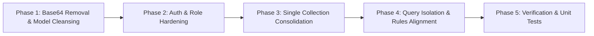
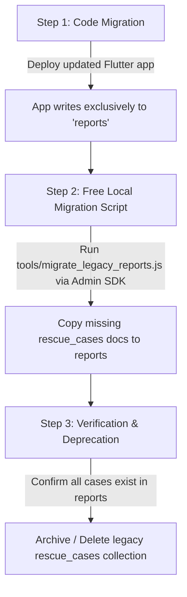

# PAW AID — Flutter Application Migration Plan

**Scope:** Code modifications, query updates, data model cleansing, and legacy collection deprecation in `flutter_app/`.  
**Firebase Plan:** Spark Tier ($0.00 / month — Strictly Free; No Billing)  
**Document Status:** Migration Plan Completed — Awaiting Approval Prior to Modifying Code

---

## 1. Migration Overview & Phased Roadmap



This migration plan eliminates all security vulnerabilities, quota wastes, and data inconsistencies identified in `FIRESTORE_SCHEMA_AUDIT.md`. It transitions the Flutter client to the proposed secure architecture without changing the application's user interface or visual design.

---

## 2. Phase 1: Base64 Image Code Removal (Task 5 & 10)

Cloud Firestore documents must never store Base64 image payloads. Photographs must be managed strictly via local device paths (`photoReference`) and upload status indicators.

### 2.1 File: `lib/data/models/case_model.dart`
* **Changes Required:**
  1. Remove field declaration:
     ```dart
     // DELETE line 18:
     final String? photoBase64;
     ```
  2. Remove constructor parameter:
     ```dart
     // DELETE line 38:
     this.photoBase64,
     ```
  3. Remove map serialization:
     ```dart
     // DELETE line 59:
     'photoBase64': photoBase64,
     ```
  4. Remove deserialization:
     ```dart
     // DELETE line 83:
     photoBase64: map['photoBase64'],
     ```

### 2.2 File: `lib/data/repositories/case_repository.dart`
* **Changes Required:**
  1. Remove `photoBase64` parameter from interface definition (line 12):
     ```dart
     // BEFORE:
     Future<void> updateCaseStatus(String caseId, String status, {String? notes, String? photoBase64});
     // AFTER:
     Future<void> updateCaseStatus(String caseId, String status, {String? notes, String? photoReference});
     ```
  2. Remove from implementation (lines 77–85):
     ```dart
     // Pass photoReference directly to ReportRepository without Base64 conversion
     @override
     Future<void> updateCaseStatus(String caseId, String status, {String? notes, String? photoReference}) async {
       final rStatus = ReportStatus.fromString(status);
       await _reportRepository.updateReportStatus(
         caseId,
         rStatus,
         notes: notes,
         photoReference: photoReference,
       );
     }
     ```

### 2.3 File: `lib/services/firestore/firestore_service.dart`
* **Changes Required:**
  1. In `createRescueCase` (lines 56–59), remove the Base64 payload length validation check:
     ```dart
     // DELETE lines 56-59:
     if (report.photoBase64 != null &&
         report.photoBase64!.length > FirebaseConstants.maxCompressedImageSizeBytes * 2) {
       throw const AppFirestoreException('Compressed image exceeds Spark single-document limit');
     }
     ```
  2. In `updateCaseStatus` (lines 139, 158), remove `photoBase64` from method arguments and from the subcollection event map:
     ```dart
     // BEFORE (lines 157-158):
     'notes': notes,
     'photoBase64': photoBase64,
     
     // AFTER:
     'notes': notes,
     'photoReference': photoReference,
     ```

### 2.4 File: `lib/core/services/rescue_service.dart`
* **Changes Required:**
  1. In `updateRescueStatus` (lines 53–58), remove `List<int>? imageBytes` parameter. All photo evidence captured in the field must be saved to the local file system using `PhotoStorageRepository.saveLocalPhoto` and referenced via file path.

---

## 3. Phase 2: Authentication & Authorization Hardening (Task 3 & 4)

### 3.1 File: `lib/services/auth/firebase_auth_service.dart`
* **Security Flaw:** Lines 67–73 sniff email substrings (`cleanEmail.contains('admin')`) and automatically assign administrative authority.
* **Remediation:**
  1. Completely delete email-based role sniffing:
     ```dart
     // DELETE lines 67-72:
     if (cleanEmail.contains('admin')) {
       inferredRole = FirebaseConstants.roleAdmin;
     } else if (cleanEmail.contains('ngo')) {
       inferredRole = FirebaseConstants.roleNgo;
       status = 'pending';
     }
     ```
  2. Replace with explicit role resolution checking the sealed `admin_roles/{uid}` collection:
     ```dart
     // SECURE ROLE RESOLUTION:
     final adminRoleDoc = await FirebaseFirestore.instance
         .collection('admin_roles')
         .doc(firebaseUser.uid)
         .get();

     final bool isSystemAdmin = adminRoleDoc.exists;
     final String assignedRole = isSystemAdmin ? FirebaseConstants.roleAdmin : FirebaseConstants.roleCitizen;
     final String assignedStatus = 'active';
     ```

### 3.2 File: `lib/core/services/ngo_service.dart` & `lib/data/repositories/ngo_repository.dart`
* **Security & Functional Defect:** `registerNGO` generates random `id = 'ngo_${DateTime.now().millisecondsSinceEpoch}'` (line 110). This breaks the 1:1 binding between the NGO Auth UID and the `ngos/{ngoId}` document, causing admin approvals to fail.
* **Remediation:**
  1. In `NgoService.registerNGO`, bind the NGO document ID to the authenticated user's UID:
     ```dart
     final currentAuthUser = FirebaseAuth.instance.currentUser;
     if (currentAuthUser == null) {
       throw const AppAuthException('User must be authenticated to register an NGO.');
     }
     final id = currentAuthUser.uid; // Exactly matches request.auth.uid
     ```
  2. In `FirestoreNgoRepository.registerNgo`, verify `doc(ngo.id)` matches `FirebaseAuth.instance.currentUser!.uid`.

### 3.3 File: `lib/core/services/auth_service.dart`
* **Remediation:**
  1. Replace hardcoded mock user fallback IDs:
     * Replace `'00000000-0000-0000-0000-000000000003'` with `FirebaseAuth.instance.currentUser?.uid`.
     * Replace `'11111111-1111-1111-1111-111111111111'` with the authenticated NGO user's UID.
  2. Isolate `signInWithRole()` to debug/demo mode only, ensuring production execution paths always invoke authentic Firebase Auth.

---

## 4. Phase 3: Single Canonical Collection (`reports`) Consolidation (Task 6)

### 4.1 Eliminate Dual-Writes in `lib/data/repositories/report_repository.dart`
Currently, every report write executes two operations in a batch: one to `reports` and one to `rescue_cases`. This wastes 50% of the Spark daily write quota.

* **Changes Required:**
  1. In `createReport` (lines 41–44):
     ```dart
     // DELETE lines 41-44:
     final legacyDoc = _firestore.collection(FirebaseConstants.colRescueCases).doc(report.reportId);
     batch.set(legacyDoc, map);
     ```
  2. In `updateReportStatus` (lines 192, 208):
     ```dart
     // DELETE lines 192 and 208:
     final legacyDoc = _firestore.collection(FirebaseConstants.colRescueCases).doc(reportId);
     batch.update(legacyDoc, updateMap);
     ```
  3. In `assignReport` (lines 240, 253):
     ```dart
     // DELETE lines 240 and 253:
     final legacyDoc = _firestore.collection(FirebaseConstants.colRescueCases).doc(reportId);
     batch.update(legacyDoc, updateMap);
     ```
  4. In `getReport` (lines 72–76):
     ```dart
     // DELETE legacy fallback read:
     final legacy = await _firestore.collection(FirebaseConstants.colRescueCases).doc(reportId).get();
     if (legacy.exists && legacy.data() != null) {
       return ReportModel.fromMap(legacy.data()!, legacy.id);
     }
     ```

### 4.2 Legacy Collection Migration Strategy
To transition any existing documents in `rescue_cases` or `cases` to `reports`:



#### Migration Script (`tools/migrate_legacy_reports.js`):
A free, zero-compute script executed locally by the developer/admin via the Firebase Admin SDK:
```javascript
const admin = require('firebase-admin');
const serviceAccount = require('./serviceAccountKey.json');
admin.initializeApp({ credential: admin.credential.cert(serviceAccount) });
const db = admin.firestore();

async function migrateLegacyCases() {
  console.log('Starting legacy collection migration to canonical reports...');
  const snapshot = await db.collection('rescue_cases').get();
  let migratedCount = 0;

  for (const doc of snapshot.docs) {
    const reportRef = db.collection('reports').doc(doc.id);
    const existing = await reportRef.get();
    if (!existing.exists) {
      await reportRef.set(doc.data());
      migratedCount++;
    }
  }

  console.log(`Migration complete: ${migratedCount} legacy reports copied to 'reports'.`);
}

migrateLegacyCases().catch(console.error);
```

---

## 5. Phase 4: Query Isolation & Rules Alignment (Task 1 & 2)

### 5.1 Citizen Query Alignment
* **Requirement:** Citizens can read only their own reports.
* **File:** `lib/data/repositories/report_repository.dart`
* **Changes:**
  Ensure all citizen queries enforce `citizenId == currentUser.uid`:
  ```dart
  @override
  Stream<List<ReportModel>> streamCitizenReports(String citizenId) {
    return _reportsRef
        .where('citizenId', isEqualTo: citizenId)
        .orderBy('createdAt', descending: true)
        .limit(FirebaseConstants.defaultPageSize)
        .snapshots()
        .map((snapshot) =>
            snapshot.docs.map((d) => ReportModel.fromMap(d.data(), d.id)).toList());
  }
  ```

### 5.2 NGO Query Alignment & Dispatch Workflow
* **Requirement:** NGOs can read and update only reports assigned to them; cannot self-assign.
* **File:** `lib/data/repositories/report_repository.dart` & `lib/core/services/ngo_service.dart`
* **Changes:**
  1. Replace unrestricted `streamRescueQueue()` with an assigned case query:
     ```dart
     // Stream only cases formally assigned to this NGO:
     Query<Map<String, dynamic>> query = _reportsRef
         .where('assignedNgoId', isEqualTo: currentNgoId)
         .where('reportStatus', whereIn: [
           ReportStatus.assigned.code,
           ReportStatus.accepted.code,
           ReportStatus.rescuerOnTheWay.code,
           ReportStatus.animalRescued.code,
           ReportStatus.treatmentInProgress.code,
         ])
         .orderBy('createdAt', descending: true)
         .limit(FirebaseConstants.defaultPageSize);
     ```
  2. In `lib/core/services/rescue_service.dart`, update `acceptRescueReport`:
     * Remove direct report assignment.
     * The NGO responds to an existing `assignments/{assignmentId}` by calling `AssignmentRepository.acceptAssignment(assignmentId)`.
     * `AssignmentRepository` updates the assignment to `ACCEPTED` and updates the parent report status to `ACCEPTED`.

---

## 6. Phase 5: Verification & Testing Plan

### 6.1 Unit Test Suite Execution
Run all local unit tests to verify model parsing, status progression, and repository contracts:
```powershell
cd flutter_app
flutter test test/firestore_workflow_test.dart
flutter test test/auth_test.dart
```

### 6.2 Security Rules Verification Matrix (Firebase Local Emulator)
Execute security rules unit tests using the Firebase Emulator Suite (zero cloud spend):
1. **Test Case 1 (Citizen Isolation):**
   * Authenticate as Citizen A (`uid: 'cit-1'`).
   * Attempt `get(/reports/rep-cit-2)` (owned by Citizen B).
   * **Expected:** Denied (`PERMISSION_DENIED`).
2. **Test Case 2 (NGO Self-Assignment Block):**
   * Authenticate as NGO (`uid: 'ngo-1'`).
   * Attempt `update(/reports/rep-1)` setting `assignedNgoId: 'ngo-1'` on an unassigned report.
   * **Expected:** Denied (`PERMISSION_DENIED`).
3. **Test Case 3 (Base64 Injection Block):**
   * Authenticate as Citizen A.
   * Attempt `create(/reports/rep-test)` with payload containing `photoBase64: 'data:image/jpeg;base64,...'`.
   * **Expected:** Denied (`PERMISSION_DENIED`).
4. **Test Case 4 (Admin Role Client Write Block):**
   * Authenticate as Citizen A or NGO.
   * Attempt `set(/admin_roles/cit-1, { role: 'admin' })`.
   * **Expected:** Denied (`PERMISSION_DENIED`).
5. **Test Case 5 (Admin Verification):**
   * Add `admin-uid-1` to `admin_roles/admin-uid-1` via mock console.
   * Authenticate as `admin-uid-1`.
   * Attempt `get(/reports/rep-cit-2)` and `update(/ngos/ngo-1, { status: 'approved' })`.
   * **Expected:** Allowed.
